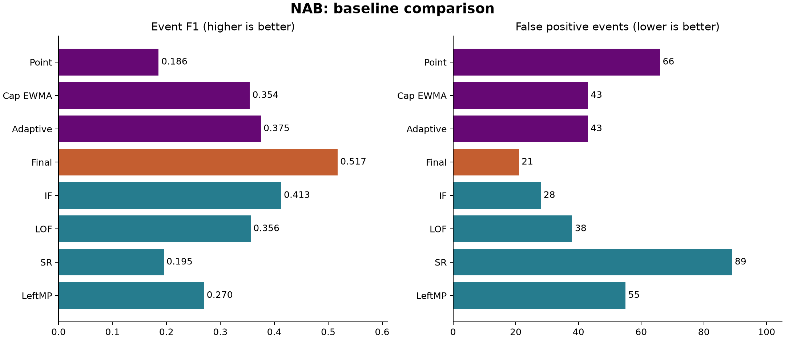
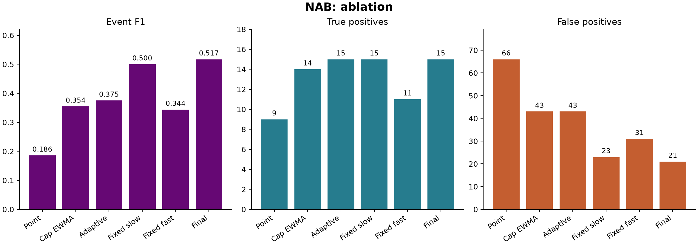

# 面向NAB多场景业务指标的周期感知与互补融合异常检测

**课程名称**：数据仓库与数据挖掘  
**小组成员**：第9组 李思懿（组长）、翁汇坤  

## 1. 背景与问题定义

### 1.1 应用场景与数据构成

在云基础设施监控、城市交通运行感知与互联网社交舆情监测等业务场景中，核心性能与业务量指标通常以单变量时间序列形式持续写入时序数据库。本项目面向 Apache IoTDB 2.0.11 树模型（Tree Model）下的单变量流式异常检测任务，目标是在“先预测评分、后更新状态”的因果流式条件下，同时处理周期强度各异的业务序列与持续时间不同的异常形态，在控制报警数量的同时保持异常窗口检出能力。

项目早期原型仅在 NYC Taxi 单一序列按旧日期切分的 5 个异常窗口上检验了基础周期方法。为扩展评估范围，本研究采用 Numenta Anomaly Benchmark（NAB）[11]（上游仓库固定提交 `ea702d75cc2258d9d7dd35ca8e5e2539d71f3140`，MIT 许可）。NAB 上游共提供 47 条真实业务候选序列，本项目按四项确定性规则进行预筛选：全序列观测值为有限实数、时间戳构成唯一完整的规则采样网格、采样步长整除一天（24 小时），且序列前 40%（训练段）至少覆盖 4 个完整日周期加 1 个采样点。预筛选过程不插补缺失值，也不依据模型检测表现挑选样本。最终共有 21 条真实序列入选、26 条排除（其中 25 条网格不完整、7 条训练历史不足，两类原因存在重叠）。

入选的 21 条序列合计 223,878 个实测点，按时间顺序划分为 40% 训练段、20% 验证校准段与 40% 测试段（测试段共 89,559 个实测点），覆盖同一基准下的三类业务场景：
* **AWS 云监控指标（9 条，8 个测试窗口）**：包含 6 条 EC2 CPU 利用率、1 条 RDS CPU 利用率、1 条磁盘写入以及 `grok_asg_anomaly` 序列。
* **已知原因（Known Cause）监控指标（2 条，5 个测试窗口）**：包含 NYC 出租车客流与自动伸缩集群 CPU 序列（其中 NYC 序列在当前 40/20/40 切分下为 4 个窗口，与早期旧日期案例的 5 窗口口径不同）。
* **Twitter 股票代码推文计数（10 条，9 个测试窗口）**：记录不同上市公司股票代码的每 5 分钟推文量。

异常标签直接采用上游 `combined_windows.json` 官方窗口，与测试段相交共得 22 个异常窗口（分布在 16 条测试序列中，另有 5 条测试序列在测试段内无异常窗口但同样纳入评价），官方窗口边界未作修改。

### 1.2 问题动机与设计目标

在线流式监测需要同时应对序列周期差异与异常跨度差异。一方面，不同业务序列的日/周周期强弱不一，单一的固定相位模板或单一自回归模型难以同时适配强周期与弱周期序列。另一方面，逐点残差判定侧重响应短促突变，但容易产生较多零散报警；输入限幅的指数加权移动平均（EWMA）侧重平滑短期波动并累积持续偏移，但会弱化短脉冲信号；若仅靠提高固定阈值压低报警数，又会直接降低窗口召回率。

围绕上述问题，本项目设计了结合训练期周期/稳健自回归分流、创新残差与局部水平联合评分、以及快慢双预设互补融合的因果流式检测方法，并将单路核心检测算子实现为独立的 Java 内核，再封装为 IoTDB 用户定义表值函数（UDTF），在统一的合成异常校准协议下与 4 种文献独立基线及内部消融变体开展对比实验。

## 2. 算法设计与系统实现

### 2.1 周期点基线与自适应分支 A

模型仅在训练段内从满足热身长度的日周期与周周期候选中，按滞后（lag）自相关系数择优确定主周期 P。

**基础周期点检测（Periodic-Point）** 在任意时刻 t 取同相位历史缓存中最近 K = 3 个值的中位数作为基线预测值 b_t，计算当前残差 r_t = x_t - b_t。残差中心 m_t 与尺度 s_t（含正下界保护）并非按各相位独立估计，而是由时刻 t 之前最近 P 个全局历史真实残差统一计算中位数与中位绝对偏差（MAD，s_t 基于 1.4826 × MAD [6]），输出逐点偏离分数：

score_t = |r_t - m_t| / s_t

模型遵循先评分后更新顺序：完成时刻 t 的评分后，同相位历史缓存按 2 倍残差尺度执行有界截断（clip = 2）写入（因此后续时刻读取的同相位历史为有界更新后的缓存值，而非全部为原始未截断观测值）；原始真实残差则照常写入全局残差窗口，不因报警或标签剔除样本。

**自适应分支 A** 依据训练段周期自相关系数是否达到 0.5 对全部 21 条序列分流（保留全部弱周期序列）：
* **强周期子分支（3 条序列，训练相关 ≥ 0.5）**：采用上述同相位 K = 3 缓存中位数预测与过去 P 个全局真实残差中位数/MAD 标准化，并将分母下界设为训练段尺度中位数的 0.5 倍，计算带符号标准化残差 (r_t - m_t) / s_t。
* **稳健自回归（AR）子分支（18 条序列，训练相关 < 0.5）**：在 Python 离线阶段用训练段拟合固定线性系数，Java 在线阶段按固定系数做因果预测。特征滞后集合取 unique(1, 2, 3, 6, 12, P, 2P)，全部滞后共享原始训练序列的单一中位数中心与稳健尺度，标准化后限幅于 [-6, +6]。最多抽取 5000 个等距训练点，通过 8 轮迭代重加权最小二乘（IRLS）求解 Huber 稳健回归 [8]（阈值 delta = 1.345，岭正则系数 0.001 × n，截距不罚）。

在稳健 AR 在线评分阶段，受时间序列分析中区分预测残差与水平变化视角的启发 [9]（仅作理论背景参考，非完整统计干预检验复现），本项目设计了创新偏离度 zAR 与局部水平偏离度 zLevel 的联合证据 u_t。其中 zAR 由过去 P 个预测残差的中位数/MAD 计算，zLevel 由过去 P 个原始观测值的中位数/MAD 计算，二者分母均设不低于训练尺度中位数 0.5 倍的下界。联合证据定义为：

u_t = sign(zAR_t) × sqrt(|zAR_t| × |zLevel_t|)

在平滑与验证归一化阶段，强周期子分支以带符号标准化残差为输入，在输入限幅的指数加权移动平均（EWMA）[7] span = 6（输入限幅 cap = 6）与 span = 12（cap = 4）中候选；稳健 AR 子分支以联合证据 u_t 为输入，除上述两种 EWMA 外额外包含逐点（point）候选。平滑递推式为：

E_t = (1 - alpha) × E_{t-1} + alpha × input_clipped，其中 alpha = 2 / (span + 1)

分支 A 的各候选模式先按各自验证段背景绝对分数的 99% 分位数（q99）归一化，再由验证校准选定模式与阈值 τ_A。当 AR 分支遇到时间戳缺口或非有限值时，立即清空内部状态并重新热身。

### 2.2 双预设周期分支 B 与互补融合

为兼顾不同持续时间的异常，方案引入周期辅助分支 B 的两种预设：**快速预设（P_score）** 为原始周期点检测分数；**慢速预设（S_score）** 为原始周期残差经 EWMA span = 12（cap = 4）平滑后的分数（不含分支 A 的学习下界与 q99 归一化）。预设阈值 τ_P 与 τ_S 同样在验证校准段确定。

在互补融合层（异常检测集成背景参见 [10]，具体双路方案由本项目设计），系统将自适应分支 A 与周期预设分支 B 按各自校准阈值对齐后取算术均值，形成两种候选融合模式：

Fast-Fusion = 0.5 × (A / τ_A + P_score / τ_P)  
Slow-Fusion = 0.5 × (A / τ_A + S_score / τ_S)

该均值既非概率估计，也不是要求两路同时越界的硬逻辑“与”（AND）。融合阈值 τ_fuse 满足 τ_fuse ≥ 1.0，仅在验证段按背景报警预算上调。每条序列在验证校准段依据三套合成注入的平均事件 F2 表现，从快速融合与慢速融合中择一固定（21 条序列最终选定慢速融合 18 条、快速融合 3 条）。

### 2.3 文献基线与系统实现

实验纳入 4 种文献独立基线与多组内部消融变体：
1. **Isolation Forest（IF）[1] 与 Local Outlier Factor（LOF）[2]**：调用 scikit-learn 1.7.2（IF 取 200 棵树、`max_samples = 256`；LOF 取 `novelty = True`、20 邻居）。以因果滑动尾窗（候选宽度 1, 8, 24）构造特征，仅用训练段标准化与拟合（最多 5000 个训练窗口）。
2. **Spectral Residual（SR）[3]**：按论文数学公式独立实现因果尾窗频谱残差（候选窗口 64, 128, 256），末尾预测延拓点不读取未来观测，为纯无监督 SR 而非 SR-CNN。
3. **Left Matrix Profile（Left-MP）[4, 5]**：参照 Matrix Profile 定义 [4] 与 DAMP 有界左侧历史思想 [5]，在最近最多 2048 个合法非重叠历史起点中精确计算当前子序列（候选长度 m = 16, 48）的 z-normalized 最近邻距离（非完整 DAMP 剪枝加速实现）。

系统基于 Java 17、Maven 3.9、IoTDB 2.0.11 Tree 模型与 Python 3.12 构建。`detector-core` 为纯 Java 核心算子模块；`detector-udf` 以 `provided` 方式依赖 IoTDB 接口，每个查询实例维护独立状态，每次调用按参数输出 `score`、`flag`、`event` 或 `active` 单一结果列；`runner` 支持 CSV 与数据库双端运行。Python 端负责离线参数拟合、验证选参、双路互补融合与指标评价（当前双路融合在库外 Python 层对既有 Java 分数执行，尚未封装为完整融合 UDF）。

### 2.4 代码结构与运行方式

系统按 Java 内核、IoTDB 封装、运行器与 Python 实验脚本分层组织，仓库根目录为 `dw-periodic-ad`。

- **环境依赖**：Java 17、Maven 3.9.x、Python 3.12；Apache IoTDB 2.0.11（Tree 模式）仅在与数据库端对比的验证与性能实验中需要。
- **核心模块**：`detector-core` 为纯 Java 检测算子库（周期基线、限幅、MAD 尺度、EWMA、稳健 AR）；`detector-udf` 为 IoTDB UDTF 封装，按序列维护独立状态，IoTDB 依赖以 `provided` 引入；`runner` 支持 CSV 与数据库双端运行。
- **实验脚本**：`scripts/benchmark_iteration2.py` 负责 7 种基础方法的训练、校准与评价；`scripts/nab_fusion.py` 实现 Python 层快慢分支融合；`scripts/evaluation.py` 定义事件合并、窗口命中与指标口径；`configs/expanded-manifest.json` 与 `configs/iteration2.json` 记录序列来源筛选元数据与评测协议。
- **复现流程**：在仓库根目录依次执行以下命令，完成虚拟环境、依赖安装、Java 打包、数据准备与完整实验。

```bash
python3.12 -m venv .venv
.venv/bin/python -m pip install -r requirements-lock.txt
mvn -DskipTests package
.venv/bin/python scripts/prepare_expanded.py --download
.venv/bin/python scripts/run_submission_experiment.py
```

- **运行约定**：`--download` 拉取并锁定 NAB 官方提交 `ea702d75`，仓库本身不保存原始数据；若已存在 `results/iteration2/final-nab/selection.json`，完整实验入口拒绝覆盖，需在新克隆目录重跑。主实验纯离线运行，不启动 IoTDB。若工作区已含 `results/submission/nab-replay` 归档，可用 `.venv/bin/python scripts/reproduce_submission.py` 直接基于归档分数重选模式并重算指标。
- **数据库端可选验证**：

```bash
.venv/bin/python scripts/setup_runtime.py
source scripts/env.sh
bash scripts/iotdb.sh start
bash scripts/deploy_detector.sh
.venv/bin/python scripts/benchmark_adaptive_database.py --output results/local-ar-performance
bash scripts/iotdb.sh stop
```

该流程固定连接本地 `127.0.0.1` 测试实例并在库内创建设备与时间序列，仅用于本地验证，结束后执行 `bash scripts/iotdb.sh stop`。

## 3. 实验结果与分析

### 3.1 合成异常校准协议与评价口径

所有参评方法遵循 40% / 20% / 40% 划分与统一的合成异常校准协议。模型训练与验证校准均不读取真实异常标签（因此验证段约束称为背景报警预算，而非已确认正常背景上的误报率）。校准段构造短脉冲（1/2/4 点）、持续偏移与常数平线三套合成异常，每套含 6 处固定注入，幅度由训练段尺度确定。各方法在背景点报警目标 ≤ 0.5%、背景合并事件约每 14 天 1 次（至少允许 1 次）及注入窗外点报警目标 ≤ 1% 的预算下，优先按三套注入的平均事件 F2 选定配置（保留超额回退记录）。全序列参数与模式在读取测试标签前选定保存。由于 NAB 在项目开发过程中已被反复使用，整体方法不属于全新盲测；但逐序列参数拟合与选参严格仅读取各自的训练段与验证校准段。

评价阶段在各方法共同可评分历史位置上，将间隔 1 小时以内的报警点合并为连续事件，按事件起点归属测试段与闭区间官方窗口。每窗首次命中事件计为 TP，同窗后续重复事件及窗外事件计为 FP，未命中窗口计为 FN，计算事件级精确率 P、召回率 R 与 F1 = 2TP / (2TP + FP + FN)（非官方 NAB 加权分数，不执行 point adjustment；因官方窗口较宽，点级 FPR 与 AP 仅作宽窗口代理指标）。

### 3.2 基线对比与消融分析

实验共评测 10 种方法：3 种单路配置（周期点检测、慢速周期 EWMA、自适应分支 A）、3 种融合配置（固定快速融合、固定慢速融合、验证段自适应快慢选择的最终融合）以及 4 种文献独立基线（Isolation Forest、LOF、Spectral Residual、Left-MP）。

表 1 给出了最终互补融合方案、内部消融变体与 4 种文献独立基线在 NAB 全量 21 条序列（22 个官方窗口）上的评测结果。

| 方法 | TP | FP | FN | 精确率 | 召回率 | 事件 F1 | 窗外点 FPR |
| --- | --- | --- | --- | --- | --- | --- | --- |
| 周期点检测 | 9 | 66 | 13 | 0.120 | 0.409 | 0.1856 | 0.34% |
| 慢速周期 EWMA | 14 | 43 | 8 | 0.246 | 0.636 | 0.3544 | 1.18% |
| 自适应分支 | 15 | 43 | 7 | 0.259 | 0.682 | 0.3750 | 0.07% |
| 固定慢速融合 | 15 | 23 | 7 | 0.395 | 0.682 | 0.5000 | 0.26% |
| 固定快速融合 | 11 | 31 | 11 | 0.262 | 0.500 | 0.3438 | 0.15% |
| 最终快慢融合 | 15 | 21 | 7 | 0.417 | 0.682 | 0.5172 | 0.12% |
| Isolation Forest | 13 | 28 | 9 | 0.317 | 0.591 | 0.4127 | 2.16% |
| LOF | 13 | 38 | 9 | 0.255 | 0.591 | 0.3562 | 1.79% |
| SR | 12 | 89 | 10 | 0.119 | 0.545 | 0.1951 | 0.11% |
| Left-MP | 12 | 55 | 10 | 0.179 | 0.545 | 0.2697 | 0.15% |

如图 1 所示，在全体 21 条序列上，最终互补融合方案取得了 0.517241 的事件级 F1（TP = 15，FP = 21，FN = 7，P = 0.416667，R = 0.681818，其中 21 次误报含窗外 9 次、窗内重复 12 次，窗外点级 FPR 为 0.1206%）。在全体事件级 F1 上，最终方案高于全部 4 种文献独立基线；相较于表现最强的外部基线 Isolation Forest（F1 = 0.412698，窗外点级 FPR 2.1604%），最终方案多命中 2 个窗口且事件误报少 7 次。



结合图 2 的内部消融结果可以观察到各配置的指标变化：
1. **单路变体表现**：基础周期点检测为 9 TP / 66 FP（F1 = 0.185567），慢速周期分支为 14 TP / 43 FP（F1 = 0.354430），单路自适应分支 A 为 15 TP / 43 FP（F1 = 0.375000，窗外点级 FPR 为 0.0714%）。
2. **互补融合与快慢选择表现**：相较于单路自适应分支 A，最终互补融合的总命中窗口数同为 15 个（具体命中的窗口集合不完全相同），事件误报从 43 次降至 21 次（减少 51.2%）。固定快速融合为 11 TP / 31 FP（F1 = 0.343750），固定慢速融合为 15 TP / 23 FP（F1 = 0.500000），验证校准选择快慢模式后误报进一步减少 2 次。
3. **分项指标与场景子集表现**：在窗外点级 FPR 上，最终融合（0.1206%）低于慢速周期分支（1.1847%）与 IF（2.1604%），但高于单路自适应分支 A（0.0714%）。按业务子集统计，最终融合在 AWS（F1 = 0.5455）与 Twitter（F1 = 0.6667）子集上高于外部基线，但在 Known Cause（2 条序列）子集上事件 F1 为 0.3810，低于 Left-MP 的 0.4348（未做统计显著性检验）。



在逐窗案例上（附录 A 保留了全部 22 个窗口的完整记录），分数与阈值关系及事件起点规则可解释具体窗口的判定结果：在 `NAB02 (ec2_cpu_utilization_24ae8d)` 第 2 个测试窗口中，最终融合的最高归一化比值 `score / τ` 为 1.027 且在窗内产生新事件起点从而计为 TP，而 IF 比值为 0.926 未达阈值漏检；在 `NAB17 (Twitter_volume_FB)` 窗口中，最终融合最高比值为 0.987 未达阈值漏检，而 IF 达到 1.014 命中。

### 3.3 IoTDB 库内一致性与组件性能

在系统核验中，写入 IoTDB 2.0.11 的稳健 AR 序列（3,168 个有效点）与周期序列（8,976 个有效点）在 `score`、`flag`、`event`、`active` 四种模式下，库内 UDF 查询与库外 Java 运行结果逐行完全一致，两次独立查询结果一致。

表 2 给出了冻结同一稳健 AR 模型、用公开 NAB 序列平铺构造 10k、100k 与 1M 点规模（平铺仅用于测量算子耗时，不增加精度样本数），经 2 轮预热、5 轮测量取中位数的运行时间。

| 输入点数 | 库内 UDF/ms | 取原值＋同 Java/ms |
| --- | --- | --- |
| 10,000 | 153.8 | 124.0 |
| 100,000 | 1,240.4 | 1,205.0 |
| 1,000,000 | 13,011.1 | 11,895.0 |

在 10k、100k 与 1M 规模下，库内 UDF 查询耗时分别为 153.8 ms、1240.4 ms 与 13011.1 ms，“读取原值查询 + 库外调用同一 Java 内核”耗时分别为 124.0 ms、1205.0 ms 与 11895.0 ms。实测库内 UDF 耗时略高于库外运行，未观察到库内加速；两组耗时均包含从数据库读取数据的时间，不含数据导入、结果写出与 Python 融合层耗时。

测试用例、实验入口与复现步骤见同目录《测试用例与实验描述》；本节只保留结果分析。

## 4. 反思与总结

### 4.1 设计取舍与客观局限

本项目设计训练期相关性分流以分别处理强弱周期序列，设计创新残差与局部水平联合评分以综合预测偏差与水平变化，并通过双路阈值比值平均与快慢模式选择，在 NAB 上将单路自适应分支 A 的 43 次事件误报降至 21 次（保持 15 个命中窗口），全体事件级 F1 高于 4 种文献独立基线。

同时，当前工作仍存在四点明确局限：
1. **漏检窗口**：22 个官方窗口中仍有 7 个窗口漏检；这 7 个窗口内的最高融合分数均未超过对应阈值。
2. **分项指标与子集未全面领先**：最终融合的窗外点级 FPR（0.1206%）高于单路自适应分支 A（0.0714%），在 Known Cause 子集上的事件 F1（0.3810）低于 Left-MP（0.4348）。
3. **开发暴露边界**：尽管逐序列参数与模式仅由训练段和验证段确定，但 NAB 数据集在方法迭代过程中已被多次使用，结果不属于全新盲测，结论亦仅限于 NAB 的三类业务场景。
4. **融合尚未合入 UDF**：单路周期与 AR 算子已在 IoTDB 内完成一致性验证，但双路融合仍在外部 Python 层执行。

### 4.2 后续工作计划

后续工作包括：一是以当前冻结的方法与选参流程在未参与开发的新时间段序列上进行验证；二是改进验证段合成注入的代表性并分析报警延迟；三是将双路互补融合实现为完整的 Java UDF 并评估其库内运行开销。

## 5. 附录 A：数据与逐窗口说明

本节汇总入选的 21 条 NAB 真实序列（覆盖 AWS、KnownCause、Tweets 三个子域）在后 40% 测试段内全部 22 个真实异常窗口的逐窗口检测明细。需注意，本项目在多轮开发迭代中已使用该 NAB 子集进行比较，并非全新盲测；原始时间字符串本身不带时区偏移，处理时统一按 UTC 坐标编码解析，不代表事件发生地的声明业务时区（其中 NYC 出租车序列在当前 40%/20%/40% 切分下包含 4 个测试窗口，与早期按旧日期范围统计的 5 窗口口径不同）。

表中的 `Y / N` 列表示事件级命中判定，即是否有合并后（全历史 1 小时合并、按起点判定）的报警事件起点落入该闭区间窗口。表中列出的窗口内最高“分数/阈值比”仅反映相对异常强度，并非统计概率值；此外，该比值经四舍五入显示为 `1.000` 时不能直接代替底层的真实浮点越限判定，且若某次连续异常报警事件的起点发生于真实窗口左边界之前，即便窗口内部仍存在越限正点，按事件起点归属规则该窗口同样不会计为命中（TP）。

### 窗口定位

| 编号 | 序列 | 起点 | 终点 |
|---|---|---|---|
| NAB-01 | realAWSCloudwatch/ec2_cpu_utilization_24ae8d.csv | 2014-02-26 13:45:00 | 2014-02-27 06:25:00 |
| NAB-02 | realAWSCloudwatch/ec2_cpu_utilization_24ae8d.csv | 2014-02-27 08:55:00 | 2014-02-28 01:35:00 |
| NAB-03 | realAWSCloudwatch/ec2_cpu_utilization_53ea38.csv | 2014-02-23 11:45:00 | 2014-02-24 04:25:00 |
| NAB-04 | realAWSCloudwatch/ec2_cpu_utilization_5f5533.csv | 2014-02-24 10:17:00 | 2014-02-25 02:57:00 |
| NAB-05 | realAWSCloudwatch/ec2_cpu_utilization_fe7f93.csv | 2014-02-23 09:42:00 | 2014-02-23 20:52:00 |
| NAB-06 | realAWSCloudwatch/ec2_disk_write_bytes_c0d644.csv | 2014-04-12 21:25:00 | 2014-04-13 08:35:00 |
| NAB-07 | realAWSCloudwatch/grok_asg_anomaly.csv | 2014-01-28 18:20:00 | 2014-01-29 07:10:00 |
| NAB-08 | realAWSCloudwatch/rds_cpu_utilization_e47b3b.csv | 2014-04-18 15:07:00 | 2014-04-19 07:47:00 |
| NAB-09 | realKnownCause/cpu_utilization_asg_misconfiguration.csv | 2014-07-10 12:29:00 | 2014-07-15 17:19:00 |
| NAB-10 | realKnownCause/nyc_taxi.csv | 2014-11-25 12:00:00 | 2014-11-29 19:00:00 |
| NAB-11 | realKnownCause/nyc_taxi.csv | 2014-12-23 11:30:00 | 2014-12-27 18:30:00 |
| NAB-12 | realKnownCause/nyc_taxi.csv | 2014-12-29 21:30:00 | 2015-01-03 04:30:00 |
| NAB-13 | realKnownCause/nyc_taxi.csv | 2015-01-24 20:30:00 | 2015-01-29 03:30:00 |
| NAB-14 | realTweets/Twitter_volume_AMZN.csv | 2015-04-01 05:32:53 | 2015-04-02 14:22:53 |
| NAB-15 | realTweets/Twitter_volume_AMZN.csv | 2015-04-07 12:27:53 | 2015-04-08 21:17:53 |
| NAB-16 | realTweets/Twitter_volume_CVS.csv | 2015-04-14 06:07:53 | 2015-04-15 15:07:53 |
| NAB-17 | realTweets/Twitter_volume_FB.csv | 2015-04-02 08:52:53 | 2015-04-05 02:42:53 |
| NAB-18 | realTweets/Twitter_volume_GOOG.csv | 2015-03-31 12:57:53 | 2015-04-01 21:57:53 |
| NAB-19 | realTweets/Twitter_volume_IBM.csv | 2015-04-19 11:02:53 | 2015-04-22 05:12:53 |
| NAB-20 | realTweets/Twitter_volume_KO.csv | 2015-04-08 01:42:53 | 2015-04-09 21:42:53 |
| NAB-21 | realTweets/Twitter_volume_KO.csv | 2015-04-13 16:52:53 | 2015-04-15 12:52:53 |
| NAB-22 | realTweets/Twitter_volume_PFE.csv | 2015-04-07 07:12:53 | 2015-04-08 16:12:53 |

### 命中与 max-score/tau

Y/N 表示是否命中；括号内为比值，空值以 — 表示。

| 编号 | Final | IF | LOF | SR | LeftMP |
|---|---:|---:|---:|---:|---:|
| NAB-01 | Y (1.307) | Y (1.101) | Y (6.150) | N (0.791) | N (0.994) |
| NAB-02 | Y (1.027) | N (0.926) | Y (19.840) | N (0.603) | Y (1.013) |
| NAB-03 | Y (1.160) | Y (1.073) | N (1.000) | Y (1.161) | Y (1.086) |
| NAB-04 | Y (2.946) | Y (1.099) | Y (5.384) | N (0.883) | Y (1.069) |
| NAB-05 | N (0.207) | N (0.654) | N (0.287) | N (0.644) | N (0.334) |
| NAB-06 | N (0.477) | N (0.384) | N (0.000) | N (0.000) | N (0.000) |
| NAB-07 | Y (1.001) | Y (1.025) | Y (185.383) | Y (1.002) | Y (1.052) |
| NAB-08 | Y (3.594) | Y (1.018) | N (0.586) | Y (1.775) | Y (1.096) |
| NAB-09 | Y (1.063) | N (0.988) | Y (7142.825) | N (0.979) | Y (1.016) |
| NAB-10 | Y (1.201) | N (0.875) | N (0.768) | N (0.865) | Y (1.421) |
| NAB-11 | Y (1.226) | N (0.892) | Y (1.051) | Y (1.020) | Y (1.176) |
| NAB-12 | N (0.971) | N (0.999) | Y (1.261) | Y (2.840) | Y (1.109) |
| NAB-13 | Y (1.240) | N (0.892) | Y (3.048) | Y (2.177) | Y (1.145) |
| NAB-14 | N (0.597) | Y (1.025) | N (0.142) | N (0.777) | N (0.921) |
| NAB-15 | Y (1.478) | Y (1.103) | N (0.000) | N (0.803) | N (0.954) |
| NAB-16 | Y (1.011) | N (0.801) | Y (3.836) | Y (1.223) | N (0.967) |
| NAB-17 | N (0.987) | Y (1.014) | Y (4.088) | Y (1.256) | N (0.975) |
| NAB-18 | N (0.991) | Y (1.028) | N (0.231) | Y (1.162) | N (0.945) |
| NAB-19 | Y (1.291) | Y (1.064) | N (1.000) | Y (1.240) | Y (1.004) |
| NAB-20 | Y (1.241) | Y (1.007) | Y (2.413) | Y (2.364) | N (0.965) |
| NAB-21 | Y (4.470) | Y (1.007) | Y (9.693) | N (0.736) | Y (1.006) |
| NAB-22 | N (0.767) | Y (1.004) | Y (2.162) | Y (1.033) | N (0.997) |

## 6. 附录 B：论文、实现与数据来源

### 1. 参考文献与项目实现对照

以下列出本实验引用的核心算法文献、统计方法依据与基准数据集来源，并说明本仓库代码实现与原论文的具体对应关系及适配边界。

1. **Fei Tony Liu, Kai Ming Ting, Zhi-Hua Zhou.** *Isolation Forest.* In Proceedings of the 2008 Eighth IEEE International Conference on Data Mining (ICDM), 2008. DOI: [10.1109/ICDM.2008.17](https://doi.org/10.1109/ICDM.2008.17)
   - **项目实现说明**：采用 `scikit-learn 1.7.2` 实现，固定参数为 `n_estimators=200`、`max_samples=256`，以 `-score_samples` 作为异常分数。为适配单变量流式因果检测，本项目引入因果尾窗（窗口长度取 1、8、24）构造特征，仅使用训练集标准化并在训练集上最多采样 5,000 个窗口完成拟合；因果尾窗特征工程属于本项目的实验适配。

2. **Markus M. Breunig, Hans-Peter Kriegel, Raymond T. Ng, Jörg Sander.** *LOF: Identifying Density-Based Local Outliers.* In Proceedings of the 2000 ACM SIGMOD International Conference on Management of Data (SIGMOD), pp. 93–104, 2000. DOI: [10.1145/342009.335388](https://doi.org/10.1145/342009.335388)
   - **项目实现说明**：采用 `scikit-learn 1.7.2` 实现，启用 `novelty=True` 模式并设 `n_neighbors=20`。因果尾窗特征构造、训练集标准化及最多 5,000 个训练样本的采样策略与 Isolation Forest 保持一致，模型仅在训练段拟合，验证段与测试段严格执行样本外推断。

3. **Hansheng Ren, Bixiong Xu, Yujing Wang, Chao Yi, Congrui Huang, Xiaoyu Kou, Tony Xing, Mao Yang, Jie Tong, Qi Zhang.** *Time-Series Anomaly Detection Service at Microsoft.* In Proceedings of the 25th ACM SIGKDD International Conference on Knowledge Discovery & Data Mining (KDD), 2019. DOI: [10.1145/3292500.3330680](https://doi.org/10.1145/3292500.3330680)；预印本：[https://arxiv.org/pdf/1906.03821](https://arxiv.org/pdf/1906.03821)
   - **项目实现说明**：在 `scripts/literature_baselines.py` 中依据论文数学定义独立实现了纯频谱残差（Spectral Residual, SR）算法，不包含有监督的 SR-CNN 后段网络。为保证在线因果性，实现采用长度为 64、128、256 的因果滑动尾窗，仅对尾端做预测延拓而不使用任何真实未来点；对数频谱振幅局部均值滤波窗口设为 3，显著图（saliency map）局部均值窗口设为 21，最终异常分数取当前真实尾点的显著度相对于其局部均值的相对绝对偏差（即绝对偏差除以局部均值）。由于评测口径不同，本实验未与原论文带 point adjustment 的 $F_1$ 指标做直接数值比较。

4. **Chin-Chia Michael Yeh, Yan Zhu, Liudmila Ulanova, Nurjahan Begum, Yifei Ding, Hoang Anh Dau, Diego Furtado Silva, Abdullah Mueen, Eamonn Keogh.** *Matrix Profile I: All Pairs Similarity Joins for Time Series: A Unifying View That Includes Motifs, Discords and Shapelets.* In 2016 IEEE 16th International Conference on Data Mining (ICDM), 2016. DOI: [10.1109/ICDM.2016.0179](https://doi.org/10.1109/ICDM.2016.0179)

5. **Yue Lu, Renjie Wu, Abdullah Mueen, Maria A. Zuluaga, Eamonn Keogh.** *Matrix Profile XXIV: Scaling Time Series Anomaly Detection to Trillions of Datapoints and Ultra-fast Arriving Data Streams.* In Proceedings of the 28th ACM SIGKDD Conference on Knowledge Discovery and Data Mining (KDD), 2022. DOI: [10.1145/3534678.3539271](https://doi.org/10.1145/3534678.3539271)
   - **项目实现说明（对应文献 [4][5]）**：在 `scripts/literature_baselines.py` 中实现了因果左侧矩阵轮廓（Left-MP）。对每个当前时刻，直接在此前最近最多 2,048 个合法非重叠左侧候选起点中，精确计算当前长度为 $m$（$m \in \{16, 48\}$）的尾子序列与候选历史子序列之间的 z-normalized 欧氏距离最近邻。该实现借鉴了文献 [5] 仅向左侧有界历史检索的因果思想，但并非完整 DAMP 算法复现，也不包含其候选剪枝与超大规模吞吐加速机制。

6. **Peter J. Rousseeuw, Christophe Croux.** *Alternatives to the Median Absolute Deviation.* Journal of the American Statistical Association (JASA), 88(424): 1273–1283, 1993. DOI: [10.1080/01621459.1993.10476408](https://doi.org/10.1080/01621459.1993.10476408)
   - **项目实现说明**：作为本项目中位数绝对偏差（MAD）稳健尺度估计与正态一致性因子缩放的理论依据；项目仅使用经典 MAD 尺度及下界保护，未复现该文提出的 $S_n$、$Q_n$ 等替代尺度算子。

7. **S. W. Roberts.** *Control Chart Tests Based on Geometric Moving Averages.* Technometrics, 1(3): 239–250, 1959. DOI: [10.1080/00401706.1959.10489860](https://doi.org/10.1080/00401706.1959.10489860)
   - **项目实现说明**：作为在线残差平滑中指数加权移动平均（EWMA）统计控制图的理论依据。

8. **Peter J. Huber.** *Robust Regression: Asymptotics, Conjectures and Monte Carlo.* The Annals of Statistics, 1(5): 799–821, 1973. DOI: [10.1214/aos/1176342503](https://doi.org/10.1214/aos/1176342503)
   - **项目实现说明**：作为弱周期路由分支中 Huber 损失稳健自回归（Robust AR）参数估计的理论依据。

9. **Ruey S. Tsay.** *Outliers, Level Shifts, and Variance Changes in Time Series.* Journal of Forecasting, 7(1): 1–20, 1988. DOI: [10.1002/for.3980070102](https://doi.org/10.1002/for.3980070102)
   - **项目实现说明**：作为区分瞬时点异常与持续水平偏移（level shift）、设计残差限幅与快慢响应机制的分析动机，本项目未复现该文完整的迭代干预检验流程。

10. **Charu C. Aggarwal, Saket Sathe.** *Outlier Ensembles: An Introduction.* Springer, 2017. DOI: [10.1007/978-3-319-54765-7](https://doi.org/10.1007/978-3-319-54765-7)
    - **项目实现说明**：作为多分支异常分数标准化与集成融合的一般方法论背景。本项目所采用的“周期/AR 分支 + 快慢响应分支、按各自验证集阈值归一化后等权均值融合、再由合成验证集优选模式”的具体架构属于项目自主组合设计，并非原书中某一特定现成算法的直接复现。

11. **Alexander Lavin, Subutai Ahmad.** *Evaluating Real-Time Anomaly Detection Algorithms—The Numenta Anomaly Benchmark.* In 2015 IEEE 14th International Conference on Machine Learning and Applications (ICMLA), 2015. DOI: [10.1109/ICMLA.2015.141](https://doi.org/10.1109/ICMLA.2015.141)
    - **项目实现说明**：本实验所评测的 NAB 基准数据集来源文献。

### 2. NAB 数据集版本、许可与筛选说明

- **官方仓库与固定版本**：数据取自 [https://github.com/numenta/NAB](https://github.com/numenta/NAB)，实验锁定的 Git 提交版本为 `ea702d75cc2258d9d7dd35ca8e5e2539d71f3140`。数据目录说明见该版本下的 [data/README.md](https://github.com/numenta/NAB/blob/ea702d75cc2258d9d7dd35ca8e5e2539d71f3140/data/README.md)，异常窗口标签文件 `labels/combined_windows.json` 与开源许可证 `LICENSE.txt`（MIT License）均取自同一提交根目录。
- **总体构成与入选分布**：NAB 原始仓库共包含 58 条时间序列（47 条真实数据、11 条人工合成数据）。本实验仅从 47 条真实序列中按等间隔网格与历史长度规则筛选出 21 条序列，候选序列的来源路径、采样步长、总点数及入选状态等元数据记录于 `configs/expanded-manifest.json`。入选的 21 条序列涵盖以下 3 个子目录场景（共 22 个测试段异常窗口）：
  - **AWS CloudWatch（9 条序列，8 个测试窗口）**：包含实际服务器 CPU 利用率、磁盘写入字节数及 Grok 应用实例监控指标（入选子集中不包含网络流量序列）。
  - **KnownCause（2 条序列，5 个测试窗口）**：仅包含纽约出租车乘车量（`nyc_taxi`）与自动伸缩组 CPU 使用率配置异常（`cpu_utilization_asg_misconfiguration`）两条序列。
  - **Twitter Tweets（10 条序列，9 个测试窗口）**：包含按 5 分钟粒度聚合的特定上市公司股票代码提及计数序列。对于各序列中的异常事件，实验仅依据官方标注窗口评测，不额外编造未在原仓库证实的业务故障根因。
- **评测边界说明**：实验完全保留 `labels/combined_windows.json` 中的官方窗口起止边界，不做手工裁剪，仅统计落入后 40% 测试段（含与测试段相交）的 22 个异常窗口。由于本实验仅使用 NAB 单一数据仓库，且采用事件合并后的未加权 $F_1$ 而非官方非对称加权 NAB score，报告结论仅代表在该 21 条真实序列及本文事件口径下的表现。

### 引用编号说明

正文引用编号为 `[1]` Isolation Forest、`[2]` LOF、`[3]` Spectral Residual、`[4]` Matrix Profile I、`[5]` DAMP、`[6]` Rousseeuw & Croux (MAD)、`[7]` Roberts (EWMA)、`[8]` Huber 稳健回归、`[9]` Tsay（理论背景参考）、`[10]` Aggarwal & Sathe (Outlier Ensembles) 及 `[11]` Lavin & Ahmad (NAB)；完整书目信息见本节文献条目。
